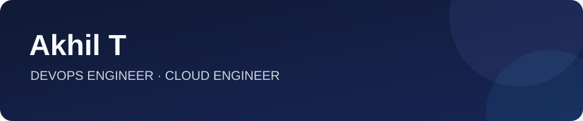

  

  <strong>DEVOPS ENGINEER · CLOUD ENGINEER</strong> 
  Secure cloud platforms. Reliable delivery. Infrastructure that scales.

  <a href="https://www.linkedin.com/in/akhilthekkuveettil">LinkedIn</a>
  ·
  <a href="mailto:akhiltofficial1@gmail.com">Email</a>

## Profile

I’m a DevOps and cloud engineer at **Founding Minds**, managing delivery across 18 projects and 10 subprojects. I build and operate AWS and Azure environments, automate infrastructure with Terraform, and strengthen the security and reliability of production systems.

From CI/CD and containers to compliance and disaster recovery, I turn operational needs into systems teams can ship and run with confidence.

## Impact

- **18 projects and 10 subprojects** supported across delivery and infrastructure.
- **30% faster deployments** after improving CI/CD pipelines.
- **50% fewer manual setup errors** through Terraform-based provisioning.
- **99.9% uptime** maintained with monitoring and reliability improvements.
- **SOC 2 Type I and II** controls implemented across infrastructure and operations.

## Tech stack

**Cloud**

**Infrastructure & delivery**

**Containers**

**Observability & security**

## Selected work

### Secure AWS application platform
Designed a highly available platform for a .NET, Angular, and MSSQL application, with isolated Dev, Staging, UAT, and Production environments. Built around EC2 Auto Scaling, an Application Load Balancer, Terraform, managed secrets, database replication, and disaster recovery.

### Compliance and security
Helped deliver SOC 2 Type I and Type II compliance for a Python, Angular, and PostgreSQL platform. Implemented controls for access, encryption, logging, vulnerability remediation, hardening, and business continuity. Contributed to HIPAA-aligned healthcare infrastructure.

### Multi-model AI integrations
Integrated Amazon Bedrock with Anthropic models and deployed local language models with Ollama. Built a secure integration layer for model switching and automated production deployments.

### Cloud reliability and recovery
Built and operated workloads across AWS virtual machines, ECS, K3s, and EKS. Applied network isolation, IAM hardening, multi-AZ design, monitoring, automated failover, and backup and restore strategies.

## Certifications

- [AWS Certified Solutions Architect – Associate](https://cp.certmetrics.com/amazon/en/public/verify/credential/1def751c26a946a48ab1928794e1751a)
- [Red Hat Certified System Administrator](https://rhtapps.redhat.com/verify?certId=210-034-104)
- [Microsoft Certified: Azure Fundamentals](https://www.credly.com/badges/3c5bb551-dbab-4f76-9035-9bda5391a5b1)

---

  <strong>Let’s build reliable infrastructure.</strong>  
  <a href="https://www.linkedin.com/in/akhilthekkuveettil">Connect on LinkedIn</a>
  ·
  <a href="mailto:akhiltofficial1@gmail.com">Get in touch</a>

